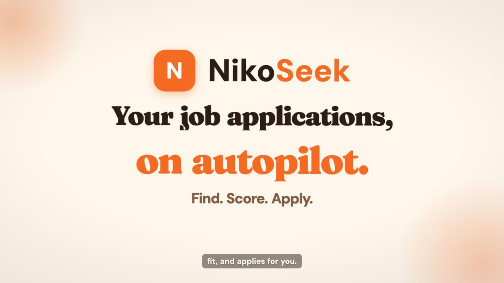
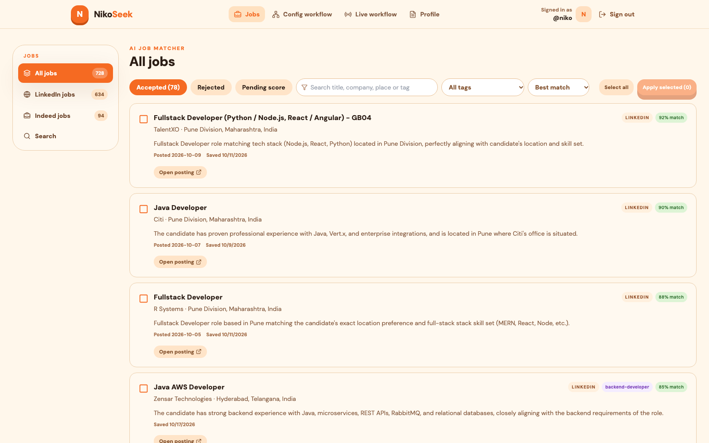
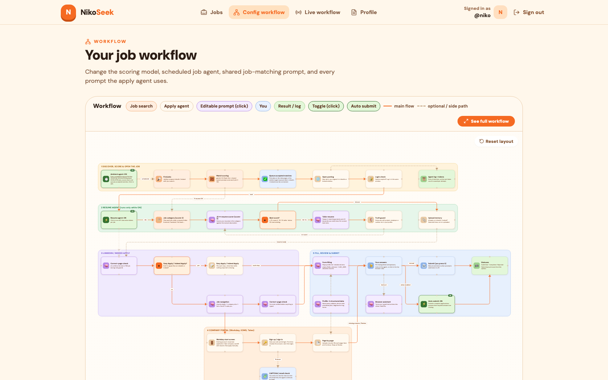
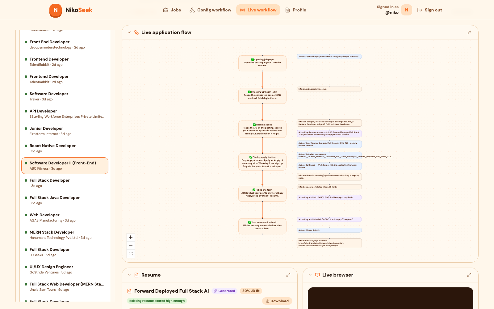
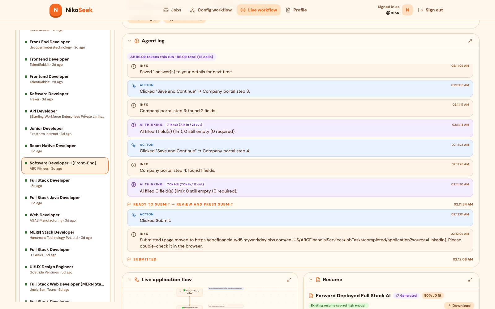
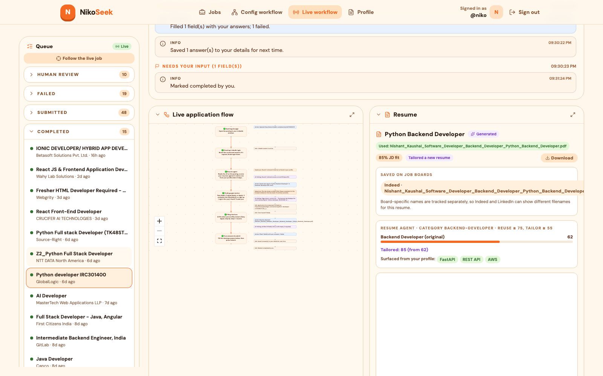
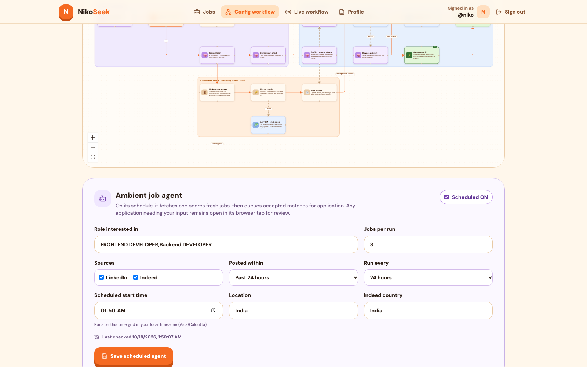
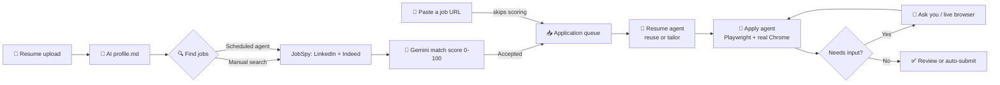

<div align="center">


An AI multi-agent platform that searches LinkedIn and Indeed, scores every job against your profile, tailors your resume per job description, and fills applications in a real browser, while keeping you in the loop.


</div>

---

## 🎥 Demo

<div align="center">

[](YOUTUBE_URL)

▶️ **[Watch the 90-second demo on YouTube](YOUTUBE_URL)**

</div>

---

## 📑 Contents

- [Demo](#-demo)
- [Features](#-features)
- [Screenshots](#-screenshots)
- [How it works](#-how-it-works)
- [Tech stack](#-tech-stack)
- [Project structure](#-project-structure)
- [Getting started](#-getting-started)
- [Configuration](#-configuration)
- [Using NikoSeek](#-using-nikoseek)
- [API overview](#-api-overview)
- [Deployment](#-deployment)
- [Troubleshooting](#-troubleshooting)
- [Disclaimer](#%EF%B8%8F-disclaimer)

---

## ✨ Features

| | Feature | What it does |
|---|---|---|
| 📄 | **Resume → AI profile** | Upload a PDF or DOCX once. An LLM extracts a private `details.md` and writes an editable `profile.md` that every agent reads from. |
| 🔗 | **Connect once** | Sign in to LinkedIn and Indeed a single time (2FA and passkeys supported) and save one email and password for company portals like Workday. Sessions are reused for every application. |
| 🔍 | **Manual search** | Search LinkedIn and Indeed by role, location, experience, salary and posting date. |
| 🔗 | **Add by URL** | Found a job yourself? Paste its LinkedIn or Indeed URL and it goes straight to the apply queue. AI match scoring is skipped; the resume agent, apply agent and your review run as usual. |
| ⏰ | **Scheduled agent** | Turn on the ambient agent to search every 6, 12, 24 or 48 hours and queue good matches automatically. |
| 🎯 | **AI match scoring** | Gemini scores every job from 0 to 100 against your profile, explains why, and sorts results into Accepted and Rejected. |
| 📝 | **Resume agent** | Compares each job description with your resumes. Reuses the best one, or writes a tailored resume when the fit is low (for example 62 → 85). |
| 🤖 | **Apply agent** | Playwright drives a real Chrome browser through Easy Apply, Indeed Apply and company portals (Workday, iCIMS, Taleo, …), filling forms from your profile. |
| 🙋 | **Human in the loop** | When it is unsure, it pauses and asks with suggested answers. Reply in the form, give plain-English instructions ("Choose India as the country"), or take over the live browser. |
| 📺 | **Live workflow** | Every step is streamed over WebSockets: queue, live application flow diagram, agent log, resume used and a live browser view. |
| ✅ | **Safe by default** | Auto-submit is opt-in. Without it, completed forms stop for your review before anything is sent. |

---

## 📸 Screenshots

| Job matcher with AI scores | Config workflow pipeline |
|---|---|
|  |  |

| Live application flow | Agent log |
|---|---|
|  |  |

| Resume agent (tailored 62 → 85) | Scheduled ambient agent |
|---|---|
|  |  |

---

## 🧠 How it works



1. **Profile.** Your resume is stored in a private Supabase Storage bucket. The LLM writes `Profile/details.md` and an editable `Profile/profile.md`.
2. **Discovery.** [JobSpy](https://pypi.org/project/python-jobspy/) scrapes LinkedIn and Indeed, either from a manual search or from the scheduled agent. Jobs you paste by URL skip discovery and scoring and go straight to the queue; their title, company and description are read from the posting when the agent opens it.
3. **Scoring.** Gemini (via Vertex AI, with an optional Groq fallback) returns `match_score`, `ai_reason` and `experience_match` for every job.
4. **Resume agent.** Each job is classified into a category. Your resumes in that category are scored against the JD, then the best one is reused or a tailored one is generated and saved.
5. **Apply agent.** One long-lived, headed Chrome per user reuses your LinkedIn and Indeed sessions. The navigator finds the apply path, the form filler tags fields and fills them from your profile, and anything missing is asked of you.
6. **Live view.** The backend streams JPEG frames of the agent's tab plus status events over WebSockets, and your clicks and typing are sent back to the same tab.

---

## 🛠 Tech stack

| Layer | Tech |
|---|---|
| **Frontend** | React 18, TypeScript, Vite, Tailwind CSS, React Flow (`@xyflow/react`), Radix UI, lucide-react |
| **Backend** | FastAPI, Uvicorn, SQLAlchemy 2, Pydantic Settings, PyJWT, Argon2 |
| **Automation** | Playwright (real Chrome, persistent profiles), JobSpy |
| **AI** | Google Gemini via Vertex AI Express (`google-genai`), Groq fallback (OpenAI-compatible) |
| **Data** | Supabase Postgres + private Supabase Storage bucket |
| **Realtime** | WebSockets for job-search progress, application events and live browser frames |

---

## 📁 Project structure

```
.
├── backend/
│   ├── app/
│   │   ├── api/routes/      # auth, profile, resumes, jobs, applications, agent_config, linkedin, indeed
│   │   ├── services/        # agents: job_matching, resume_agent, form_filler, job_navigator, cron_agent, live_view, …
│   │   ├── db/              # SQLAlchemy models and session
│   │   ├── schemas/         # Pydantic request/response models
│   │   └── ws/              # WebSocket broker
│   ├── supabase/            # setup.sql + phase_2 … phase_9 migrations
│   ├── requirements.txt
│   ├── run.py
│   └── .env.example
├── frontend/
│   └── src/
│       ├── pages/           # JobSearch, Workflow, LiveWorkflow, ProfileReview, ResumeOnboarding, Connect*
│       └── components/      # workflow panels, layout, UI primitives
├── deploy/
│   └── install_oracle.sh    # experimental VM provisioning script
└── docs/                    # screenshots and demo video
```

---

## 🚀 Getting started

### Prerequisites

- 🐍 **Python 3.11+**
- 🟢 **Node.js 18+** and npm
- 🌐 **Google Chrome** installed locally (the agent prefers real Chrome; it falls back to Playwright's Chromium)
- 🗄 A free **[Supabase](https://supabase.com)** project
- 🔑 A **Gemini API key** (Vertex AI Express Mode)
- *(Optional)* a free **[Groq](https://console.groq.com)** API key for the fallback model

### 1. Clone

```bash
git clone https://github.com/nishant0708/NIKOSEEK.git
cd NIKOSEEK
```

### 2. Set up Supabase

1. Create a Supabase project.
2. In the **SQL Editor**, run [`backend/supabase/setup.sql`](backend/supabase/setup.sql). It creates the private `job-files` bucket.
3. Run each migration in order:
   [`phase_2_matching`](backend/supabase/migrations/phase_2_matching.sql) →
   [`phase_3_agent_configuration`](backend/supabase/migrations/phase_3_agent_configuration.sql) →
   [`phase_4_applications`](backend/supabase/migrations/phase_4_applications.sql) →
   [`phase_5_browser_sessions`](backend/supabase/migrations/phase_5_browser_sessions.sql) →
   [`phase_6_application_events`](backend/supabase/migrations/phase_6_application_events.sql) →
   [`phase_7_application_tokens`](backend/supabase/migrations/phase_7_application_tokens.sql) →
   [`phase_8_resume_agent`](backend/supabase/migrations/phase_8_resume_agent.sql) →
   [`phase_9_cron_agent`](backend/supabase/migrations/phase_9_cron_agent.sql)
4. From **Connect**, copy the SQLAlchemy Postgres connection string (`DATABASE_URL`). From **Settings → API**, copy the project URL and the **service_role** key.

> ⚠️ The `service_role` key is backend-only. Never put it in frontend code.

### 3. Run the backend

```bash
cd backend
cp .env.example .env          # then fill in the values (see Configuration)
python3 -m venv .venv
.venv/bin/pip install -r requirements.txt
.venv/bin/playwright install chromium
.venv/bin/python run.py
```

The API runs at **http://localhost:8000**, with interactive docs at **http://localhost:8000/docs**.

### 4. Run the frontend

```bash
cd frontend
npm install
npm run dev
```

Open **http://localhost:5173**, create an account and upload your resume. 🎉

> The frontend calls `http://localhost:8000/api/v1` by default. Set `VITE_API_URL` to point it elsewhere.

---

## ⚙️ Configuration

All backend settings live in `backend/.env` (see [`.env.example`](backend/.env.example)).

| Variable | Required | Description |
|---|:---:|---|
| `DATABASE_URL` | ✅ | Supabase Postgres connection string (`postgresql+psycopg://…`) |
| `JWT_SECRET_KEY` | ✅ | Long random string used to sign login tokens |
| `SUPABASE_URL` | ✅ | `https://<project-ref>.supabase.co` |
| `SUPABASE_SERVICE_ROLE_KEY` | ✅ | Server-only service role key |
| `GEMINI_API_KEY` | ✅ | Vertex AI Express Mode API key |
| `SUPABASE_STORAGE_BUCKET` | | Storage bucket name (default `job-files`) |
| `AI_MODEL` | | Gemini model (default `gemini-3.5-flash-lite`) |
| `ACCESS_TOKEN_EXPIRE_MINUTES` | | Login session length (default `1440`) |
| `CORS_ORIGINS` | | Allowed frontend origins (default `http://localhost:5173`) |
| `GROQ_API_KEY`, `GROQ_MODEL`, `GROQ_BASE_URL` | | Fallback LLM used when all Gemini models fail |
| `SMTP_HOST`, `SMTP_PORT`, `SMTP_USERNAME`, `SMTP_PASSWORD`, `SMTP_FROM_EMAIL`, `SMTP_RECEIPT_EMAIL`, `SMTP_USE_TLS` | | Optional receipt emails after a submission |

Frontend: `VITE_API_URL` (optional) overrides the API base URL.

---

## 🧭 Using NikoSeek

1. **📄 Onboard.** Sign up, upload your resume, add a target role, extra projects and achievements, then click **Generate my profile**.
2. **✍️ Review your profile.** Edit the Markdown on the left and check the live preview on the right.
3. **🔗 Connect accounts.** On the Profile page, connect **LinkedIn** and **Indeed** once (a real Chrome window opens for you to sign in), and save an email and password for **company job portals**.
4. **🔍 Find jobs.** Use **Jobs → Search**, paste a posting you found in **Jobs → Add by URL**, or enable the **Ambient job agent** in **Config workflow** to search on a schedule.
5. **🎯 Review matches.** Filter and sort the **Accepted** list by match score, tag, source or date.
6. **📥 Queue.** Select jobs and click **Apply selected**.
7. **📺 Watch it work.** Open **Live workflow** to follow the flow diagram, agent log, resume choice and live browser for each application.
8. **🙋 Step in when asked.** Answer missing fields, send instructions, then press **Submit**, or enable auto-submit in **Config workflow**.

---

## 🔌 API overview

All routes are under `/api/v1`. Everything except signup and login needs `Authorization: Bearer <token>`. Full reference: **http://localhost:8000/docs**.

| Area | Endpoints |
|---|---|
| 🔐 Auth | `POST /auth/signup`, `POST /auth/login`, `GET /auth/me` |
| 📄 Profile | `GET`/`PUT /profile`, `POST /profile/generate`, `POST /profile/upload`, `GET`/`PUT /profile/linkedin`, `/profile/indeed`, `/profile/ats` |
| 📎 Resumes | `GET /resumes`, `POST /resumes`, `GET /resumes/status`, `GET /resumes/file` |
| 🔍 Jobs | `POST /jobs/scrape`, `GET /jobs`, `POST /jobs/{id}/score`, `POST /jobs/score-pending`, `GET /jobs/runs` |
| 🤖 Applications | `POST /applications/apply`, `POST /applications/from-url`, `GET /applications`, `GET /applications/{id}/events`, `POST /applications/{id}/answer`, `/instruct`, `/continue`, `/submit`, `/status`, `/recheck`, `/resume`, `/browser/input` |
| ⚙️ Agent config | `/agent-config` (scoring model, prompts, scheduled agent, resume agent, auto-submit) |
| 🔗 Sessions | `/linkedin`, `/indeed` (connect, check and disconnect the browser sessions) |
| 📡 Realtime | `WS /applications/ws?token=…` (application events and live browser frames) |

---

## ☁️ Deployment

- **Frontend:** any static host (Vercel, Netlify, Cloudflare Pages). Build with `npm run build` and set `VITE_API_URL` to your backend's HTTPS URL.
- **Backend:** needs an always-on machine with enough RAM for a real Chrome per user, a display for headed Chrome (Xvfb on Linux), persistent disk for browser profiles, and HTTPS for WebSockets. Oracle Cloud's Always Free ARM VM fits these needs. [`deploy/install_oracle.sh`](deploy/install_oracle.sh) is a starting point but is still experimental.
- **Database and storage:** Supabase free tier.

> 💡 LinkedIn and Indeed challenge logins from data-centre IPs more often than from home connections, so expect more security checks on a cloud VM.

---

## 🩺 Troubleshooting

| Problem | Fix |
|---|---|
| Chrome does not open when connecting LinkedIn/Indeed | Install Google Chrome, or run `.venv/bin/playwright install chromium` for the fallback browser |
| `401 Unauthorized` from the API | Log in again; tokens expire after `ACCESS_TOKEN_EXPIRE_MINUTES` |
| CORS errors in the browser console | Add your frontend URL to `CORS_ORIGINS` and restart the backend |
| Jobs stay at "Pending score" | Check `GEMINI_API_KEY` and `AI_MODEL`, or add a `GROQ_API_KEY` fallback |
| An application says the form is no longer open | The browser tab closed or the backend restarted. Use **Retry** in the queue |
| Supabase errors on startup | Make sure `setup.sql` and every migration up to `phase_9` have been run |

---

## ⚠️ Disclaimer

NikoSeek is a personal project for learning and experimentation with browser agents. Automating actions on LinkedIn, Indeed or other sites may go against their terms of service and can lead to account restrictions. Use it responsibly, review applications before they are sent, and you are responsible for how you use it.

<div align="center">

Made with 🧡 by [Nishant Kaushal](https://github.com/nishant0708)

</div>
